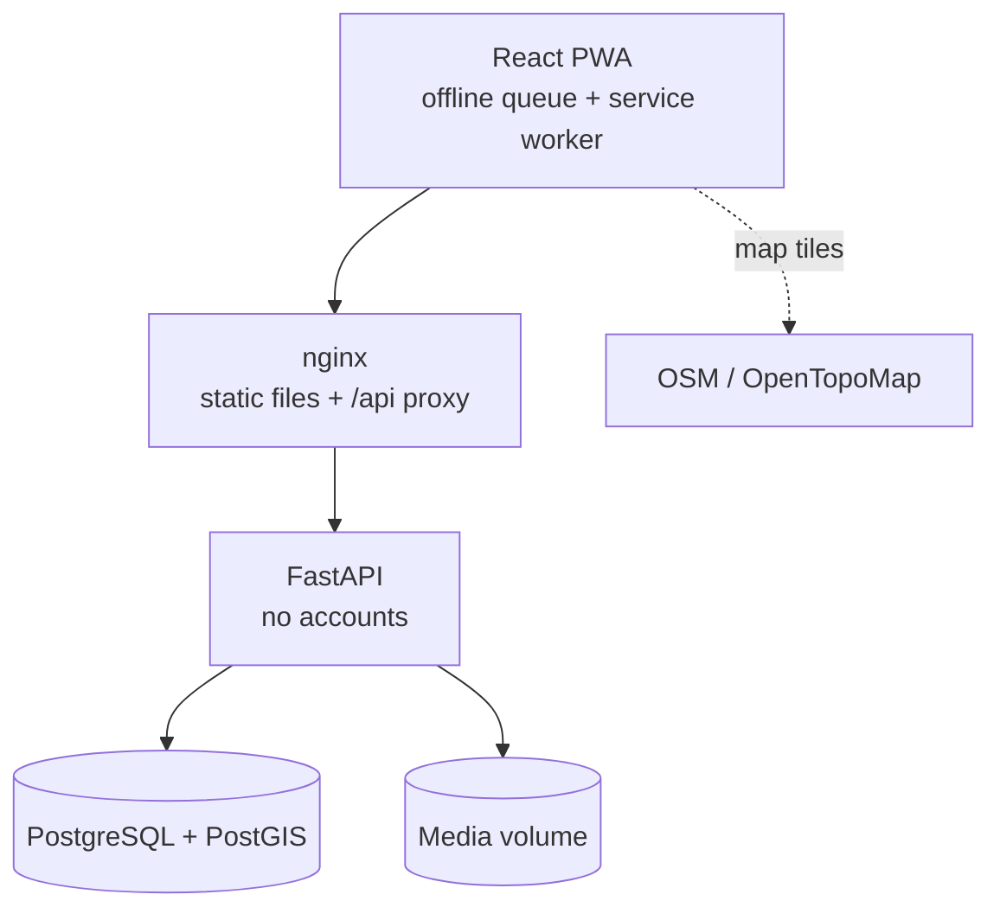

# Muzdyq · Мұздық

**English** · [Русский](docs/README.ru.md) · [Қазақша](docs/README.kk.md) · [简体中文](docs/README.zh-CN.md) · [Español](docs/README.es.md) · [Français](docs/README.fr.md) · [Deutsch](docs/README.de.md) · [Português (BR)](docs/README.pt-BR.md) · [All translations](docs/README.md)

**An account-free, open citizen-science photo time series for the glaciers and
water bodies of the Ile Alatau (Zailiysky Alatau), Kazakhstan.**

Muzdyq (Kazakh for *glacier*) lets anyone standing on a marked trail contribute a
repeatable photo of a fixed viewpoint. Over years, those photos become a public,
comparable visual record of shrinking glaciers and changing mountain lakes —
without accounts, gamification, geolocation tracking, or hidden analytics.

- **Web app:** React 19 + TypeScript + Vite PWA, Ant Design, MapLibre GL, kk/ru/en.
- **API:** FastAPI + SQLAlchemy 2 + PostgreSQL/PostGIS (SQLite fallback for dev).
- **Open data:** CSV, GeoJSON, JSON and ZIP exports, licensed **CC BY 4.0**.
- **Code:** **MIT**.
- **Citizen photos are observations, not measurements.** They do not replace
  glaciological mass-balance or survey work.

> [!IMPORTANT]
> The 7 seeded monitoring points use **approximate, unverified coordinates**
> (`coords_verified: false`). They must be checked on site and with glaciologists
> before any public release. See [`backend/seed/points.json`](backend/seed/points.json)
> and [`docs/ETHICS.md`](docs/ETHICS.md).

---

## Quick start

### Option A — Docker Compose (recommended)

Requirements: Docker Engine 24+ with the Compose plugin.

```bash
cp .env.example .env          # optional; sensible demo defaults exist
docker compose up --build
```

Open **<http://localhost:8080>**. The first start takes roughly 15–30 s: the
backend runs migrations, seeds 7 points / 8 viewpoints and generates 35 clearly
labelled synthetic demo photos.

Useful URLs:

| URL | What it is |
| --- | --- |
| <http://localhost:8080> | PWA (map, gallery, capture, exports) |
| <http://localhost:8080/docs> | Interactive OpenAPI documentation |
| <http://localhost:8000/api/health> | Direct API health (debug port) |
| <http://localhost:8080/api/export/photos.geojson> | Open data export |

Stop with `docker compose down`; add `-v` to delete the database and media
volumes as well.

### Option B — local development

Backend (Python 3.12+):

```bash
cd backend
python3 -m venv venv
source venv/bin/activate
pip install -r requirements.txt -r requirements-dev.txt
uvicorn app.main:app --reload
```

The development server listens on <http://127.0.0.1:8000>, uses
`backend/data/muzdyq.db` (SQLite) and `backend/data/media/`, and seeds itself on
startup.

Frontend (Node 22+):

```bash
cd frontend
npm ci
npm run dev
```

Open <http://127.0.0.1:5173>. Vite proxies `/api`, `/media`, `/docs` and
`/openapi.json` to the backend, so no CORS or API-key setup is needed.

### Option C — production-ish without Docker

Build the PWA and serve it with any static server that proxies `/api` to the
backend:

```bash
cd frontend
npm run build          # -> frontend/dist
```

[`deploy/nginx.conf`](deploy/nginx.conf) is a TLS-terminating example;
[`frontend/nginx.conf`](frontend/nginx.conf) is the container config.

---

## What is in the box

### Map and point panel
- MapLibre raster map (OpenStreetMap, optional OpenTopoMap in detailed mode)
  with glacier/water markers and a bounds fit to the seeded points.
- Desktop side drawer / mobile bottom sheet with description, safety note,
  coordinates, elevation and unverified-coordinate warning.
- Viewpoint selector with reference photo and a QR deep link for trailhead stands.
- Year filter, before/after comparison slider, client-side timelapse and gallery.
- CSV / GeoJSON / JSON / ZIP downloads for the selected point and globally.

### Capture flow (`/p/:slug/:viewpointId`)
- Rear camera where available, file picker fallback.
- Semi-transparent **ghost reference overlay** with adjustable opacity.
- Optional weather, visibility and snow-cover tags.
- Client-side resize (~1600 px long edge, JPEG quality 0.75), EXIF/GPS stripping,
  best-effort browser face pixelation, and thumbnail generation.
- IndexedDB upload queue with UUID idempotency, exponential backoff, manual retry
  and Background Sync where supported.
- Green mode on by default: lighter tiles, no autoplay, downloadable tile region
  for offline use, and no analytics.

### Backend
- Anonymous uploads; no accounts, no contributor identities.
- Server-side MIME/size validation, EXIF stripping, face blur (OpenCV YuNet with
  Haar fallback), thumbnails, perceptual-hash duplicate detection, hourly
  `taken_at` bucketing, and IP/device rate limiting with salted hashes.
- Token-protected moderation endpoints (`X-Admin-Token`), never exposed in the UI.
- Export endpoints return metadata plus coordinates, licence headers and the
  scientific disclaimer.

### Language and accessibility
- Kazakh, Russian and English everywhere; the switcher is always visible.
- Dark mode, keyboard navigation, skip link, WCAG-oriented contrast, and layouts
  tested at 360 px width.

---

## Architecture



The browser owns the offline queue (IndexedDB) and the service-worker caches;
nginx is the only public origin. The API talks to PostGIS for points, viewpoints
and metadata, and to the media volume for EXIF-free originals and thumbnails.

Repository layout:

```
.
├── backend/               FastAPI app, migrations, seed data, tests
│   ├── app/               API routers, models, services, image pipeline
│   ├── alembic/           initial schema + PostGIS view
│   ├── seed/points.json   reproducible monitoring points
│   └── tests/             pytest suite (28 tests)
├── frontend/              Vite + React + TypeScript PWA
│   ├── src/pages/         map/home, about, data, ethics, contribute, capture, queue
│   ├── src/lib/           API client, queue, sync, image processing, tiles
│   ├── public/sw.js       offline shell, API/media/tile caches
│   └── e2e/               Playwright smoke test
├── docs/                  DPG checklist, ethics, data licence, offline, API
├── deploy/nginx.conf      public TLS reverse-proxy example
├── docker-compose.yml     PostGIS + backend + frontend
└── .env.example
```

---

## API in one screen

All endpoints are public unless marked. There is no contributor authentication.

| Method | Path | Purpose |
| --- | --- | --- |
| `GET` | `/api/points` | All points with viewpoints, photo counts, latest thumbnail |
| `GET` | `/api/points/{slug}` | One point with viewpoints |
| `GET` | `/api/points/{slug}/photos` | Published series; `year`, `from`, `to`, `cursor`, `limit` |
| `POST` | `/api/points/{slug}/photos` | Anonymous multipart upload; `client_uuid` makes retries idempotent |
| `GET` | `/api/photos/{id}/file` | Original image (EXIF-free) |
| `GET` | `/api/photos/{id}/thumb` | Thumbnail |
| `GET` | `/api/viewpoints/{id}/reference` | Reference image for a viewpoint |
| `GET` | `/api/export/photos.csv` | Metadata CSV |
| `GET` | `/api/export/photos.geojson` | GeoJSON features |
| `GET` | `/api/export/photos.json` | Metadata bundle |
| `GET` | `/api/export/photos.zip` | Images + metadata + licence |
| `GET` | `/api/health` | Service, database, storage and model status |
| `GET` | `/docs` | OpenAPI UI |
| `GET` | `/api/admin/photos` | Moderation queue — `X-Admin-Token` |
| `GET` | `/api/admin/stats` | Counts per status — `X-Admin-Token` |
| `POST` | `/api/admin/photos/{id}/publish` | Publish — `X-Admin-Token` |
| `POST` | `/api/admin/photos/{id}/hide` | Hide with reason — `X-Admin-Token` |
| `DELETE` | `/api/admin/photos/{id}` | Permanently delete — `X-Admin-Token` |

Export filters: `?point=<slug>&from=YYYY-MM-DD&to=YYYY-MM-DD`.
Full schemas: [`docs/API.md`](docs/API.md) or the live `/docs`.

Example upload:

```bash
curl -X POST http://localhost:8080/api/points/tuyuksu-glacier/photos \
  -F "file=@photo.jpg" \
  -F "viewpoint_id=tuyuksu-glacier-v1" \
  -F "taken_at=2026-07-01T09:00:00Z" \
  -F "client_uuid=$(uuidgen)" \
  -F 'tags={"weather":"clear","snow_cover":"partial"}'
```

---

## Adding or correcting a monitoring point

1. Edit [`backend/seed/points.json`](backend/seed/points.json). Keep the file
   deterministic and sorted; the backend upserts by `slug`.
2. Provide `name_i18n` and `description_i18n` in `en`, `ru` and `kk`.
3. Add at least one viewpoint with a `heading_deg` and, ideally, a reference
   photo path.
4. Keep `coords_verified: false` until a glaciologist and a field visit confirm
   the coordinates and stand location.
5. Re-run the backend (or `python -m app.seed` inside the container). Demo images
   are only generated when missing.

Seed coordinates are approximate by design. Do not present them as surveyed.

---

## Tests and quality gates

```bash
# Backend
cd backend
./venv/bin/ruff check app tests
./venv/bin/pytest -q                 # 28 tests

# Frontend
cd frontend
npm run lint
npx tsc -b
npm test                             # 14 Vitest tests
npm run build
npm run e2e                          # Playwright smoke (mocked API)
```

Backend coverage includes EXIF stripping, face blur, upload idempotency, export
endpoints and rate limiting. The offline queue test covers retry/backoff and
UUID reuse. The Playwright smoke test runs against mocked API responses, so it
needs no backend.

CI (`.github/workflows/ci.yml`) runs backend lint/tests, frontend lint/typecheck/
unit tests/build, and the Playwright smoke test.

---

## Configuration

Copy [`.env.example`](.env.example) to `.env`. The most important settings:

| Variable | Default | Notes |
| --- | --- | --- |
| `DATABASE_URL` | SQLite in `backend/data/` | Compose uses `postgresql+psycopg://…` |
| `MEDIA_ROOT` | `./data/media` | Originals + thumbnails |
| `ADMIN_TOKEN` | dev value | **Change for any public host** |
| `IP_HASH_SALT` | dev value | **Change for any public host** |
| `SEED_DEMO` | `true` | Synthetic, labelled demo photos |
| `UPLOAD_LIMIT_PER_HOUR` | `40` | Per hashed IP/device |
| `UPLOAD_LIMIT_PER_MINUTE` | `6` | Burst protection |
| `PUBLIC_BASE_URL` | empty | Absolute URLs in exports |
| `CORS_ORIGINS` | localhost origins | Only needed for split hosting |
| `STORAGE_BACKEND` | `local` | `s3` enables S3-compatible storage |

---

## Privacy and ethics (summary)

- No accounts, profiles, leaderboards, streaks, badges or ratings.
- No GPS or EXIF metadata is uploaded or published; the client strips it and the
  server strips it again.
- Faces are blurred best-effort on device and again on the server.
- No third-party analytics, trackers or advertising cookies.
- Photos are published under **CC BY 4.0**; the contributor must have the right
  to share them and must not photograph identifiable people without consent.
- Safety guidance is shown on every contribution path. Never enter closed areas,
  glacier termini, moraines or steep snow for a photo.

Read [`docs/ETHICS.md`](docs/ETHICS.md) and the in-app **Ethics & privacy** page.

---

## Assumptions and limitations

- **Coordinates and viewpoints are unverified placeholders.** They exist to make
  the prototype usable, not to make scientific claims.
- **Demo photos are synthetic.** Every one is labelled “DEMO PHOTO — NOT A REAL
  OBSERVATION”; the `is_demo` flag is included in exports.
- **Hourly `taken_at`.** Capture times are deliberately coarsened to the hour to
  reduce re-identification risk.
- **No automatic image registration.** Before/after comparison and timelapse are
  visual aids; they do not align or rectify images.
- **Face blur is best-effort.** It is not a guarantee, and moderation is still
  required before publishing a photo.
- **Moderation is token-based and minimal.** A real deployment needs a named
  steward, a response window and an appeals process.
- **Green mode is a compromise.** The map still loads lightweight OSM tiles; the
  detailed basemap is opt-in, and offline regions are capped.
- **Bundle size.** Ant Design (~390 kB gzip) and MapLibre (~296 kB gzip) are the
  largest chunks; further route-level splitting is possible but not required for
  this reference implementation.

---

## Documentation

- [Architecture](docs/ARCHITECTURE.md)
- [API reference](docs/API.md)
- [Digital Public Good checklist](docs/DPG_CHECKLIST.md)
- [Ethics and privacy](docs/ETHICS.md)
- [Data licence and attribution](docs/DATA_LICENSE.md)
- [Offline and Green mode](docs/OFFLINE.md)
- [Contributing](CONTRIBUTING.md) · [Code of Conduct](CODE_OF_CONDUCT.md) · [Security](SECURITY.md)

---

## Licence

- **Code:** MIT — see [LICENSE](LICENSE).
- **Photographs and metadata:** CC BY 4.0 — see [docs/DATA_LICENSE.md](docs/DATA_LICENSE.md).
- **Map tiles:** © OpenStreetMap contributors (ODbL); OpenTopoMap (CC BY-SA).
- **Demo imagery:** generated for this project; no real observation is depicted.

Muzdyq is aligned with **SDG 13 (Climate Action)**, **SDG 6.6 (water-related
ecosystems)** and the principles of Digital Public Goods: open licence, open
data, privacy by design, and no lock-in.
