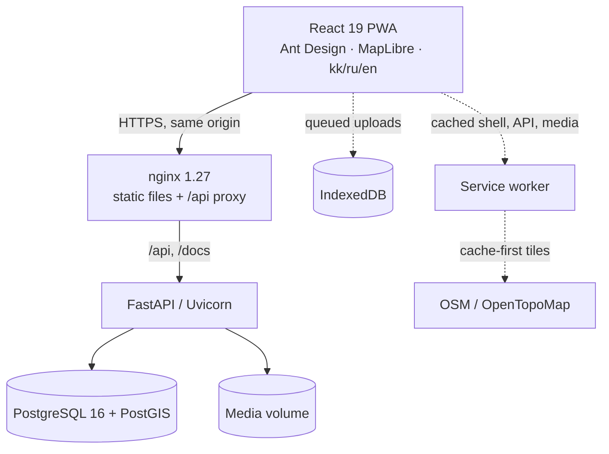
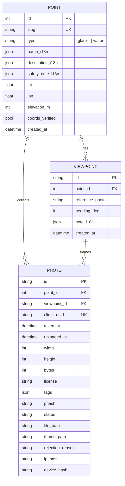

# Architecture

Muzdyq is a small three-tier system: a static PWA, a stateless FastAPI service and
a PostgreSQL/PostGIS database with a media volume. There is no identity provider,
no queue broker and no analytics service — deliberately.



The browser owns the capture pipeline, the IndexedDB upload queue and the
service-worker caches. nginx is the only public origin; FastAPI owns validation,
image processing, persistence and exports.

## Frontend

| Concern | Implementation |
| --- | --- |
| Build | Vite 8, TypeScript strict, Tailwind v4 for layout, Ant Design for controls |
| Routing | React Router 7: `/`, `/about`, `/data`, `/ethics`, `/contribute`, `/queue`, `/p/:slug/:viewpointId` |
| Server state | TanStack Query (60 s stale time for points, lazy photo pages) |
| i18n | react-i18next; `en`, `ru`, `kk`; Ant Design locale packs; detector + explicit switcher |
| Map | MapLibre GL v6 with raster OSM (green mode) or OpenTopoMap (detailed), worker URL injected via Vite `?url` |
| Capture | `getUserMedia` with file fallback; canvas resize to 1600 px at quality 0.75; native `FaceDetector` pixelation when available |
| Offline | IndexedDB queue (`idb`), service worker caches, Background Sync, exponential backoff with jitter |
| Theming | Ant Design `ConfigProvider` tokens + CSS variables; persisted light/dark/green preferences |

Key modules:

- `src/lib/api.ts` — typed client; uploads use `XMLHttpRequest` for progress and
  send `client_uuid`.
- `src/lib/image.ts` — resize, EXIF-free re-encode, best-effort face blur,
  thumbnail.
- `src/lib/queue.ts` — IndexedDB store, event notifications, atomic state moves.
- `src/lib/sync.ts` — retry eligibility, 5 s → 30 min capped backoff, sync lock,
  online/visibility/timer triggers and `registration.sync.register`.
- `src/lib/tiles.ts` — slippy-map maths and bounded tile prefetch.
- `public/sw.js` — network-first app shell and read API, cache-first media and
  tiles, cache trimming, no caching of exports or uploads.

## Backend

```
backend/app/
├── api/          points, photos, export, admin, health, deps
├── services/     images, face blur, phash, storage, rate limit
├── assets/       YuNet face-detection ONNX model
├── models.py     Point, Viewpoint, Photo
├── schemas.py    Pydantic response models
├── seed.py       idempotent JSON seeding + synthetic demo scenes
├── config.py     pydantic-settings, env-driven
├── db.py         engine/session factory (SQLite or PostgreSQL)
├── serializers.py public URL shaping
└── main.py       app factory, middleware, lifespan
```

### Data model



`point_geo` is a PostGIS view exposing point geometry for external GIS clients;
it is created by the initial Alembic migration and is not used by the API. On
SQLite (development) the view is skipped.

### Upload pipeline

1. Resolve point and viewpoint; validate that the viewpoint belongs to the point.
2. Validate the UUID early and replay an existing row if the client retried.
3. Compute salted IP/device hashes and enforce minute + hour limits.
4. Read at most `max_upload_bytes + 1` bytes; reject oversized/empty payloads.
5. Validate MIME and magic bytes, decode with Pillow, apply EXIF orientation.
6. Resize to `max_image_long_edge` (2048), re-encode JPEG, strip all metadata.
7. Blur faces with YuNet ONNX; fall back to Haar cascades; count blurred regions.
8. Compute a perceptual hash; reject near-duplicates for the same point.
9. Round `taken_at` down to the hour, whitelist tags, persist original + thumb.
10. Insert with `client_uuid` unique constraint; on a race, replay the winner.
11. Photos are published immediately in this reference build; moderators can hide
    or delete them with the admin token.

### Why uploads are idempotent

A phone may lose connectivity after the server committed the row but before the
response arrived. The client keeps the same UUID and retries; the unique
constraint plus an explicit lookup make the second request a `200` replay instead
of a duplicate photo.

### Media

`Storage` is an interface with a local-disk implementation and an optional
S3-compatible implementation (`STORAGE_BACKEND=s3`). Paths are content-agnostic
keys (`photos/YYYY/MM/<uuid>.jpg`), so switching to object storage does not
change API contracts. The Compose stack mounts a named volume at `/data/media`.

### Exports

CSV, GeoJSON, JSON and ZIP are generated on demand from published rows. They
carry the licence header, attribution and the “observations, not measurements”
disclaimer. `PUBLIC_BASE_URL` controls absolute URLs; otherwise the request base
URL is used.

## Deployment topology

Compose starts `db` → `backend` → `frontend`. The backend entrypoint retries
`alembic upgrade head` for up to 60 s, then runs `python -m app.seed` and starts
Uvicorn. nginx serves `dist/` and proxies `/api`, `/docs`, `/redoc`,
`/openapi.json`.

For a public host:

1. Set `ADMIN_TOKEN`, `IP_HASH_SALT`, `POSTGRES_PASSWORD` and `PUBLIC_BASE_URL`.
2. Set `SEED_DEMO=false` once real photos exist.
3. Put TLS in front (see `deploy/nginx.conf`).
4. Back up the database volume and media volume together.
5. Add a named steward for moderation and a published response window.

## Trade-offs

- **No accounts** keeps participation friction and privacy risk low, but means no
  per-contributor attribution, no appeals via login, and rate limiting by hashed
  IP/device only.
- **Immediate publishing** makes the prototype useful for demos; a real
  deployment should default to `pending` and require moderation.
- **Best-effort face blur** is cheap and offline-capable but not a guarantee.
- **Hourly timestamps** reduce re-identification but limit fine-grained timing
  studies; actual science should use dedicated instruments.
- **Ant Design + MapLibre** produce large but cacheable chunks; route-level
  splitting is the next optimisation if bundle size becomes a constraint.
- **SQLite fallback** keeps local onboarding fast; PostGIS is required for the
  geographic view and any production use.
